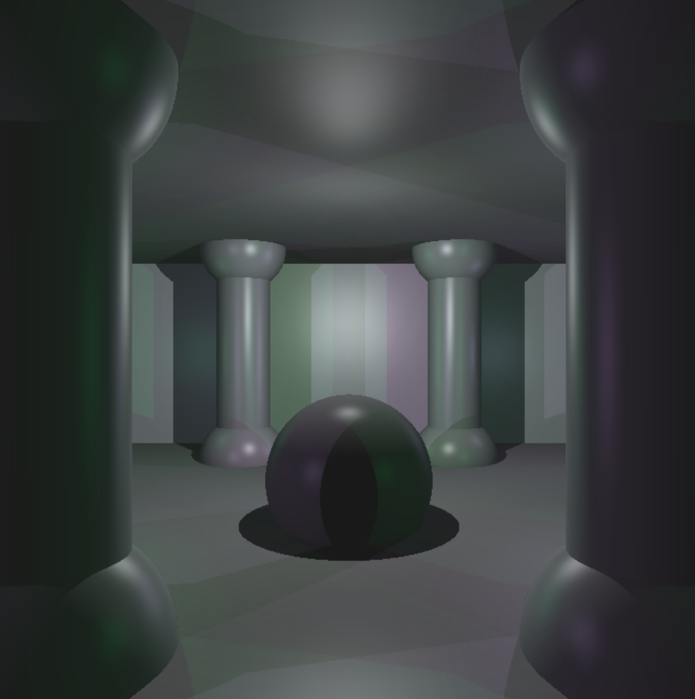
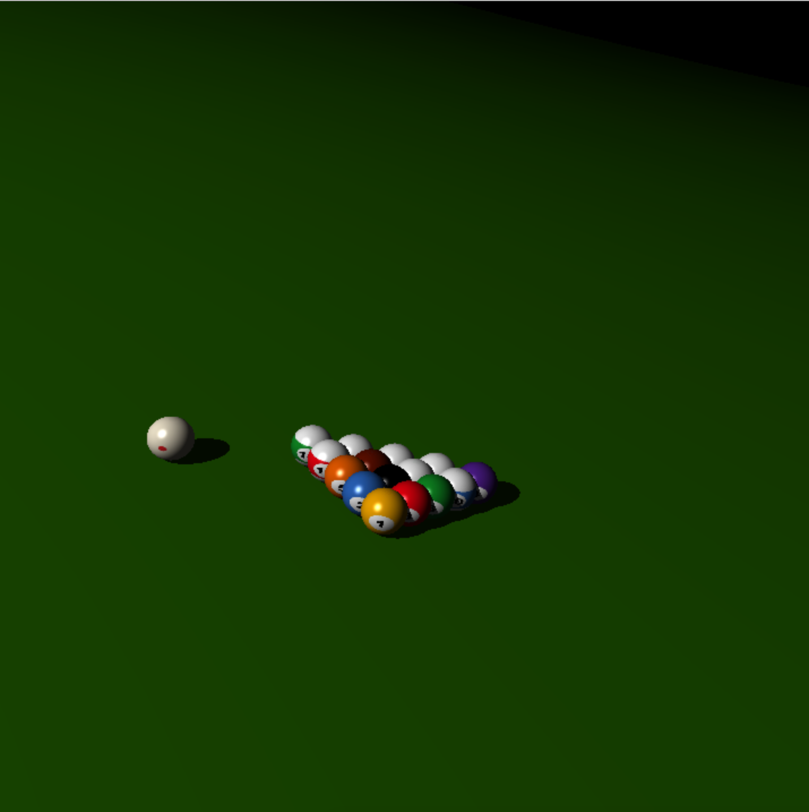
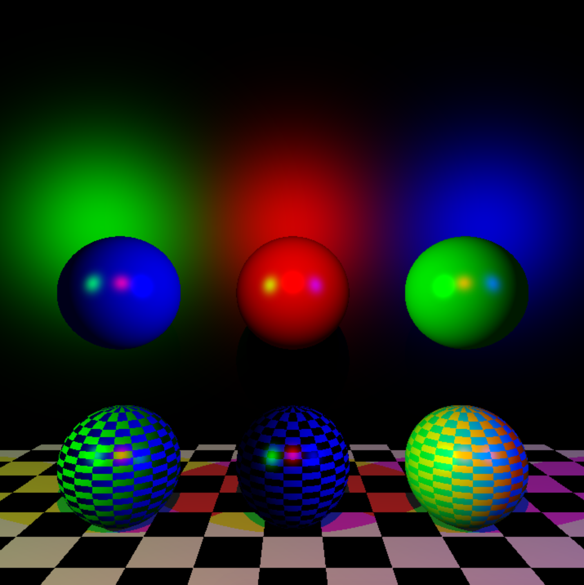
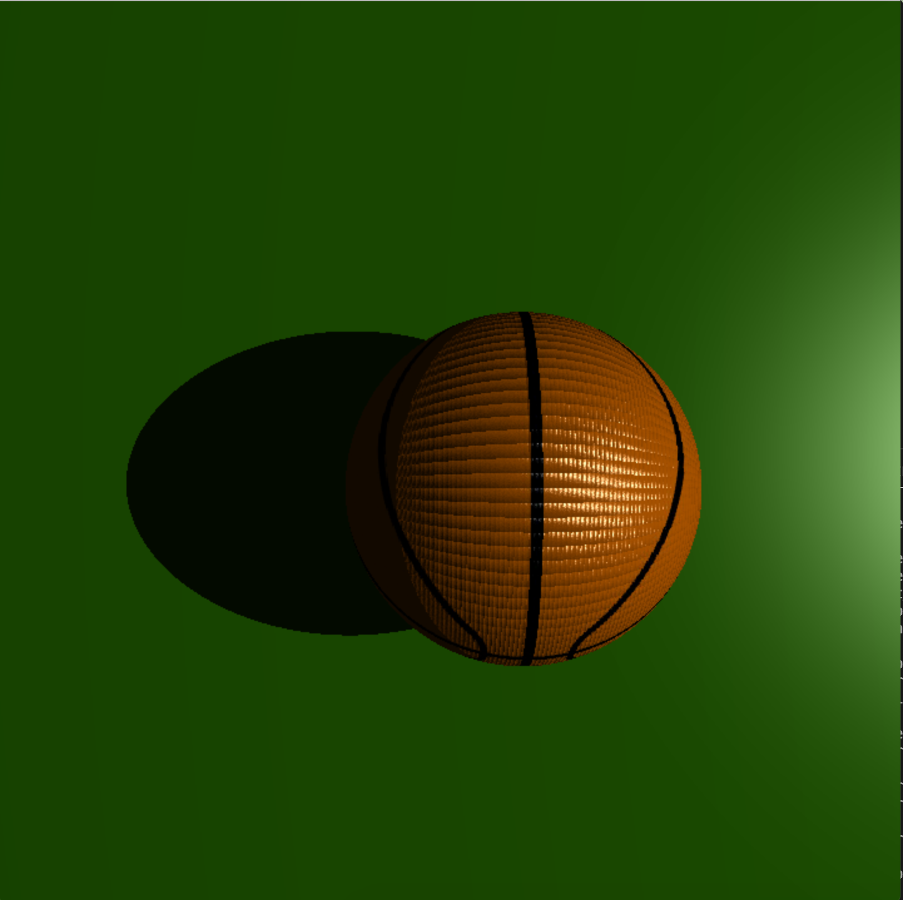

# miniRT

A ray tracer written from scratch in C for the 1337 (42 Network) curriculum, built with my teammate orekabe. It parses a `.rt` scene file, casts one ray per pixel through a 720x720 window and shades every hit with ambient, diffuse and specular lighting, hard shadows, checkerboards, textures and bump mapping.


## Features

- **Shapes:** spheres, infinite planes, capped cylinders and cubes. Cylinder caps are discs and cubes are built from six squares, so every shape is solved analytically (ray/quadric or ray/plane equations).
- **Lighting:** Phong-style model with an ambient term, Lambert diffuse and specular highlights.
- **Shadows:** a shadow ray is cast toward each light, so objects block light for each other.
- **Multiple coloured lights:** any number of point lights, each with its own brightness and colour.
- **Checkerboard patterns** on every shape, using two colours.
- **Texture mapping** from XPM images (spheres, planes, cylinders, cubes), used for the billiard and basketball scenes.
- **Bump mapping:** a procedural normal perturbation that gives textured surfaces a tiled relief. The tile count is set per object in the scene file.
- **Multithreaded rendering** in the bonus build: the image is split into six bands of rows, each rendered by its own pthread.



## Build and run

The project uses the MiniLibX graphics library and links against the macOS OpenGL and AppKit frameworks, so it builds on macOS.

```bash
make            # builds ./miniRT
make bonus      # builds ./miniRT_bonus (multithreaded renderer)
./miniRT maps/8pool.rt
```

The program takes exactly one argument, a file ending in `.rt`. Press `Esc` or close the window to quit. Ready-made scenes are in the [`maps`](maps) folder and textures in [`texture`](texture).

## Scene file format

One element per line. Empty lines and lines starting with `#` are ignored. Vectors and colours are comma-separated (`x,y,z` and `R,G,B` in 0-255).

| Element | Syntax | Notes |
|---|---|---|
| Ambient light | `A ratio R,G,B` | ratio in [0,1], declared once |
| Camera | `C x,y,z dx,dy,dz fov` | direction components in [-1,1], fov in [0,180], declared once |
| Light | `L x,y,z brightness R,G,B` | brightness in [0,1], several lights allowed |
| Sphere | `sp x,y,z radius SURFACE` | |
| Plane | `pl x,y,z nx,ny,nz SURFACE` | point on the plane and its normal |
| Cylinder | `cy x,y,z ax,ay,az radius height SURFACE` | base centre, axis direction, closed with two caps |
| Cube | `cb x,y,z dx,dy,dz half_size SURFACE` | centre, orientation, half the edge length |

`SURFACE` can be:

- `R,G,B` for a plain colour
- `R,G,B R,G,B` for a checkerboard of two colours
- `tx:path/to/image.xpm:N` for a texture, where `N` is the bump tile count (`0` turns bump mapping off)

Example (`maps/basketball.rt`):

```txt
A 0.1 255,255,255
C 0,30,0 0,-1,0 60
L 0.0,100,-100 0.9 255,255,255
pl 0,0,5 0,1,0 39,107,0
sp -1,5,-2 5 tx:texture/basketball.xpm:90
```



## How it works

1. **Parsing:** each line is validated (number of fields, value ranges) and turned into an object, light or camera setting. Invalid input stops the program with an error.
2. **Camera rays:** a ray direction is precomputed for every pixel from the camera position, direction and field of view, and the scene is moved into camera space.
3. **Intersection:** for each pixel the closest hit across all objects is kept. Spheres and cylinders solve a quadratic equation; planes, discs and squares solve a ray/plane equation and then check bounds.
4. **Shading:** at the hit point the colour comes from the base colour, checkerboard or texture, the normal is optionally perturbed for bump mapping, and the light from each visible source (diffuse plus specular) is added to the ambient term.



## Limitations

- No reflections, refraction or anti-aliasing (one ray per pixel).
- The window size is fixed at 720x720.
- The build targets macOS only.


